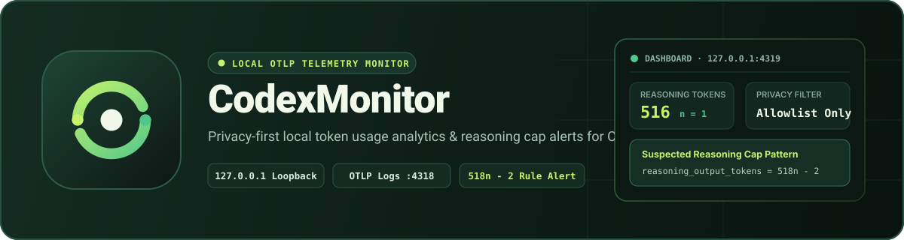
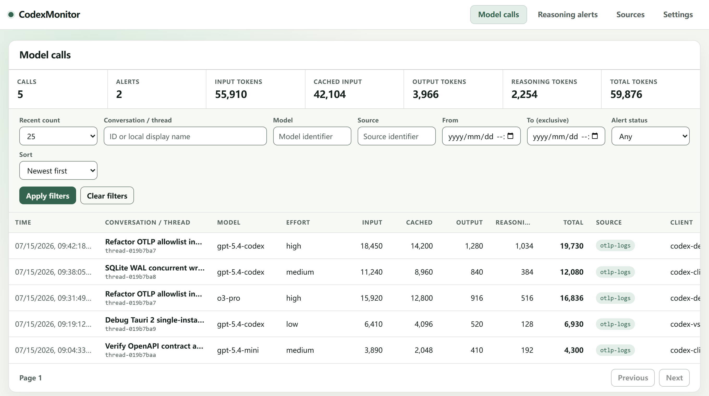
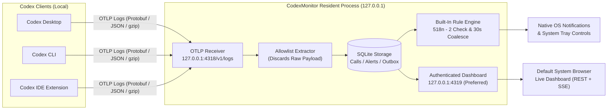

# CodexMonitor



[](https://github.com/dragonknightk/CodexMonitor/actions/workflows/ci.yml)
[](https://github.com/dragonknightk/CodexMonitor/releases)
[](LICENSE)
[](https://github.com/dragonknightk/CodexMonitor/releases)
[](docs/architecture/system-overview.md)
[](PRIVACY.md)

[简体中文（权威版本）](README.md) | **English Translation** · [Installation Guide](docs/user/installation.md) · [Privacy Policy](PRIVACY.md) · [Troubleshooting](docs/user/troubleshooting.md) · [Documentation Index](docs/index.md)

**CodexMonitor** is a private, local-only **Codex token usage analyzer and reasoning-cap alert monitor**. It receives OpenTelemetry (OTLP) log events over loopback from Codex Desktop, Codex CLI, or a Codex IDE extension, extracts strictly allowlisted metadata into a local SQLite database, and presents real-time insights through an authenticated browser Dashboard and native OS notifications.

> [!IMPORTANT]
> **Zero Outbound Telemetry & Privacy by Design**: CodexMonitor binds every network listener strictly to loopback (`127.0.0.1`) and has no default outbound telemetry, analytics, crash uploads, or update checks. It **never reads, persists, or displays** your prompts, model responses, hidden reasoning text, tool arguments, file paths, or account credentials.



---

## Key Features

### 1. Real-Time Token Usage Dashboard

- **Granular Token Breakdown**: Tracks and displays `Input`, `Cached Input`, `Output`, `Reasoning`, and `Total` token counts for every completed model call, alongside model identifier, reasoning effort, client type, and telemetry source.
- **Multi-Dimensional Filtering & Live Summary**: Filter model calls by conversation/thread (by ID or read-only local display name), model, source, time window, and alert status; sort by timestamp or token metrics; and inspect real-time aggregate summary cards matching your active filters.
- **Live SSE Synchronization**: The browser Dashboard stays automatically synchronized with newly completed model calls, rule alerts, and receiver status updates over an authenticated same-origin Server-Sent Events (SSE) stream.

### 2. Suspected Reasoning Cap (`518n - 2`) Detection & Alerts

- **Built-In Quantization Pattern Rule**: Evaluates every completed realtime model call against the reasoning-token quantization formula:
  $$\text{reasoning\_output\_tokens} = 518n - 2 \quad (n \in \mathbb{Z}^+)$$
  Matches values such as $n = 1 \rightarrow 516$, $n = 2 \rightarrow 1034$, $n = 3 \rightarrow 1552$, and $n = 4 \rightarrow 2070$ that indicate a suspected reasoning limit pattern (note: a match is an observational signal and does not by itself prove model degradation or an incorrect answer).
- **Configurable Notification Thresholds**: Choose whether to dispatch OS notifications only when $n \le k$ (defaults to $n \le 1$) or for any positive integer $n$. Regardless of notification settings or thresholds, all matched alerts are retained in Dashboard history.
- **30-Second Per-Conversation Coalescing**: Automatically coalesces burst matches within the same known conversation over a 30-second window to prevent notification fatigue while preserving full per-alert audit records.

### 3. Loopback-Only, Allowlist-First Privacy

- **Closed Telemetry Field Catalog**: Only fields explicitly registered in the reviewed [telemetry field catalog](docs/reference/telemetry-fields.md) can cross the ingestion boundary into SQLite; raw OTLP payloads are discarded immediately after in-memory decoding.
- **Read-Only Dynamic Session Labels**: Human-readable conversation titles shown in the Dashboard are resolved on the fly in memory from the local `session_index.jsonl` during authenticated queries and are **never written** to SQLite, logs, or notifications.
- **Provenance & Evidence Quality Tracking**: Distinguishes `direct` event observations from `inferred` legacy-import values using deterministic provenance priority so lower-quality evidence never overwrites higher-quality data.

### 4. Lightweight Resident Process & Desktop Integration

- **Single Normal-User Process**: Built with Rust and Tauri 2 to run without administrator privileges or system services. One resident instance hosts the OTLP receiver, SQLite storage, rule/notification workers, system tray controls, and HTTP Dashboard server.
- **Browser-First Experience**: v1 opens the authenticated Dashboard in your system default browser (protected by a one-time bootstrap credential and `HttpOnly; SameSite=Strict` session cookies) without keeping a heavy desktop WebView window in memory. **Closing all browser tabs does not stop background monitoring.**
- **Live Receiver Diagnostics & Retry**: If `127.0.0.1:4318` encounters a port conflict or decode error, the Dashboard **Telemetry Sources** view surfaces privacy-safe error codes, remediation steps, and one-click receiver retry without restarting the app.

---

## How It Works



- **Independent Local Path**: Model requests sent from Codex to OpenAI are completely separate from the local OTLP log exporter path. CodexMonitor never proxies or intercepts outbound API traffic.
- **Isolated Loopback Listeners**: The OTLP receiver binds strictly to `http://127.0.0.1:4318/v1/logs`; the Dashboard server prefers `http://127.0.0.1:4319` and automatically selects a random available loopback port if `4319` is busy.

---

## Quick Start

### Step 1: Download & Install

Download the package for your operating system and CPU architecture from [GitHub Releases](https://github.com/dragonknightk/CodexMonitor/releases):

| Platform    | Architecture   | Package Formats                              | Notes & Requirements                                                                   |
| :---------- | :------------- | :------------------------------------------- | :------------------------------------------------------------------------------------- |
| **Windows** | `x64`          | Portable `.zip` (single `codex-monitor.exe`) | Extract to a stable local directory and launch normally; no service installer required |
| **macOS**   | `x64`, `arm64` | `.app` bundle or `.dmg`                      | Requires macOS 12.0+; copy `CodexMonitor.app` to `Applications` and launch             |
| **Linux**   | `x64`          | `AppImage`, `.deb`, `.rpm`                   | Requires WebKitGTK 4.1 runtime libraries; tray integration uses AppIndicator           |

> [!NOTE]
> Development artifacts labeled `unsigned-development` are intended only for controlled testing and are not a substitute for signed or notarized formal releases. Please read the full [installation guide](docs/user/installation.md) before installing.

### Step 2: Configure Codex OTLP Log Export

In your Codex configuration, keep prompt logging, `metrics`, and `traces` disabled, and export only OTel `logs` to the local loopback receiver:

```toml
[analytics]
enabled = false

[otel]
environment = "local"
log_user_prompt = false
metrics_exporter = "none"
trace_exporter = "none"
exporter = { otlp-http = { endpoint = "http://127.0.0.1:4318/v1/logs", protocol = "binary" } }
```

**Restart Codex** after saving the configuration so the local exporter takes effect.

### Step 3: Launch & Open Dashboard

1. Launch **CodexMonitor** normally. The resident process starts listening on `127.0.0.1:4318` and opens an authenticated Dashboard session in your default browser.
2. Make a normal request in Codex.
3. Check the browser Dashboard:
   - Open **Model Calls** to inspect per-call token breakdowns and filtered summary totals;
   - Open **Reasoning Alerts** to see any `518n - 2` suspected reasoning-cap matches;
   - Open **Telemetry Sources** to verify that the `otlp-logs` receiver is `Healthy`.

---

## Usage & CLI Flags

CodexMonitor runs as a single resident instance per user session. Launching the application a second time while an instance is already running asks the existing instance to open a fresh authenticated browser tab and then exits immediately.

| Launch Mode / Flag                       | Behavior                                                                                                                                                                  |
| :--------------------------------------- | :------------------------------------------------------------------------------------------------------------------------------------------------------------------------ |
| Normal launch (no flags)                 | Starts the resident monitor and opens the Dashboard in the default browser (or opens a new tab if already running)                                                        |
| `--background`                           | Starts the resident monitor silently in the background **without** opening a browser window (used by login autostart)                                                     |
| `--quit`                                 | Requests an ordered shutdown of the running instance (flushes workers, closes listeners and SQLite cleanly)                                                               |
| `--import-legacy <absolute-sqlite-path>` | Safely imports allowlisted historical call records from an explicitly selected legacy SQLite database via the single-instance route (see [Upgrade](docs/user/upgrade.md)) |

**Operational Notes**:

- **Closing Browser Tabs Does Not Stop Monitoring**: Background ingestion and alert evaluation continue when all browser tabs are closed. Use **Quit CodexMonitor** in the system tray or run `--quit` to stop the process.
- **Autostart & Notification Settings**: Login autostart is off by default. You can toggle login autostart, system notifications, notification thresholds, retention period (`30`, `90`, `365` days, or `unlimited`), and UI language (`English` / `简体中文`) in the tray or Dashboard **Settings** view.
- **Linux Environment Behavior**: On Linux, a missing system tray (`AppIndicator`) or desktop notification service does not stop the engine, OTLP receiver, SQLite storage, or Dashboard. By contrast, if required WebKitGTK 4.1 dynamic libraries are missing, the binary cannot start at all (see [Troubleshooting](docs/user/troubleshooting.md)).

---

## Privacy & Security Boundaries

| Category                    | Allowlisted & Persisted Data                                                                                                                                | Permanently Forbidden Data (Deny-by-Default)                                                                                                      |
| :-------------------------- | :---------------------------------------------------------------------------------------------------------------------------------------------------------- | :------------------------------------------------------------------------------------------------------------------------------------------------ |
| **Call & Session Metadata** | Anonymous internal UUIDs, source event identity, UTC timestamps, client & source identifiers, model name, reasoning effort                                  | Raw OTLP request bodies, user prompts, model responses, hidden reasoning content                                                                  |
| **Token Counts & Alerts**   | Non-negative integer counts for `input`, `cached_input`, `output`, `reasoning_output`, and `total` tokens; `518n - 2` match evidence and action audit state | Tool names/arguments, shell commands, local workspace or file paths, emails/account IDs, API keys, cookies, or auth material                      |
| **Local Operational State** | Application settings (locale, retention, notification toggles/thresholds, autostart), closed safe error codes                                               | Human-readable conversation titles (resolved read-only in memory from `session_index.jsonl` at query time; **never persisted** to SQLite or logs) |

Read the complete [privacy policy](PRIVACY.md) before sharing any diagnostics or bug reports. **Never upload a production SQLite database or local Codex logs.**

---

## Documentation

- **User Guides**
  - [Installation Guide](docs/user/installation.md) ([简体中文](docs/user/installation.zh-CN.md))
  - [Upgrade & Legacy Import](docs/user/upgrade.md) ([简体中文](docs/user/upgrade.zh-CN.md))
  - [Uninstall & Delete Data](docs/user/uninstall.md) ([简体中文](docs/user/uninstall.zh-CN.md))
  - [Troubleshooting](docs/user/troubleshooting.md) ([简体中文](docs/user/troubleshooting.zh-CN.md))
  - [Privacy Policy](PRIVACY.md) ([简体中文](PRIVACY.zh-CN.md))
- **Architecture & Developer Reference**
  - [Documentation Index](docs/index.md)
  - [System Overview](docs/architecture/system-overview.md) · [Process Lifecycle](docs/architecture/process-lifecycle.md) · [Monitoring Domain Model](docs/domain/monitoring-model.md)
  - [Telemetry Field Catalog](docs/reference/telemetry-fields.md) · [Registered Telemetry Sources](docs/reference/telemetry-sources.md) · [Database Schema](docs/reference/database-schema.md)

---

## Development & Verification

The repository uses pinned Rust (`1.97`), Node.js (`>=24.0.0`), and `pnpm@11.13.0` toolchains. From the repository root:

```text
pnpm install --frozen-lockfile
pnpm build:app
pnpm verify
```

Use synthetic fixtures only. See [standard development commands](docs/development/commands.md) and the [testing strategy](docs/development/testing.md) for details.
