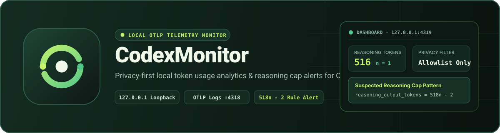
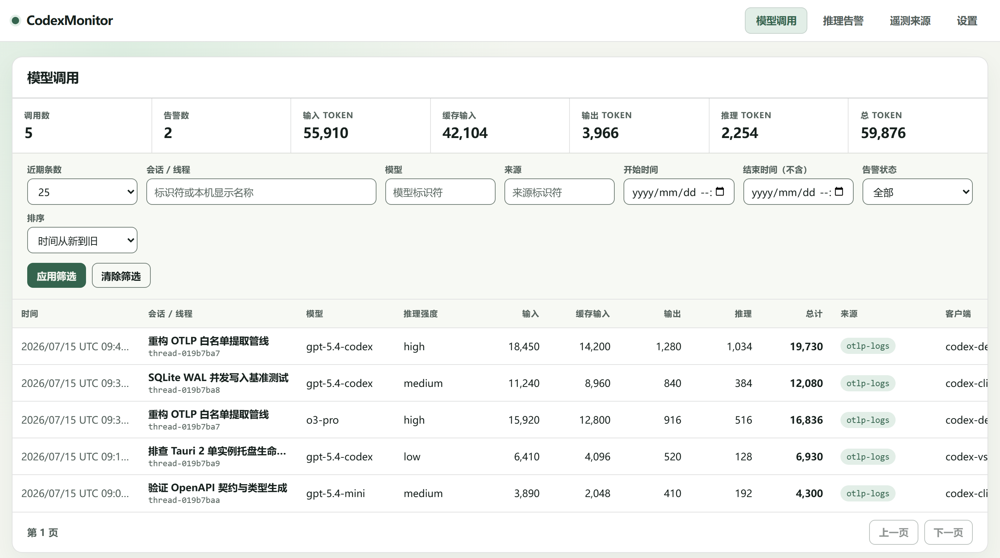
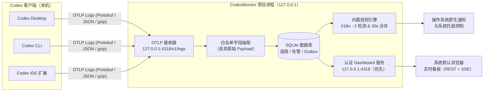

# CodexMonitor



[](https://github.com/dragonknightk/CodexMonitor/actions/workflows/ci.yml)
[](https://github.com/dragonknightk/CodexMonitor/releases)
[](LICENSE)
[](https://github.com/dragonknightk/CodexMonitor/releases)
[](docs/architecture/system-overview.md)
[](PRIVACY.zh-CN.md)

**简体中文（权威版本）** | [English Translation](README.en.md) · [安装指南](docs/user/installation.zh-CN.md) · [隐私说明](PRIVACY.zh-CN.md) · [故障排查](docs/user/troubleshooting.zh-CN.md) · [文档索引](docs/index.md)

**CodexMonitor** 是一个纯本机运行的 **Codex Token 用量分析与推理上限告警监控器**。它通过回环地址接收来自 Codex Desktop、Codex CLI 或 Codex IDE 扩展的 OpenTelemetry（OTLP）日志事件，严格按白名单提取结构化元数据并持久化至本机 SQLite，同时提供经过身份验证的浏览器实时看板（Dashboard）与原生系统通知。

> [!IMPORTANT]
> **零外发与强隐私承诺**：CodexMonitor 所有网络监听器仅绑定本机回环地址（`127.0.0.1`），默认无任何外发遥测、分析、崩溃上传或自动更新检查。它**绝不读取、持久化或展示**你的提示词（Prompt）、模型回答、隐藏思维链（Reasoning 原文）、工具调用参数、文件路径或账户凭据。



---

## 核心特性

### 1. 实时 Token 用量看板与多维分析

- **全维度 Token 拆解**：记录并展示每次已完成模型调用的 `输入 (Input)`、`缓存输入 (Cached Input)`、`输出 (Output)`、`推理 (Reasoning)` 与 `总计 (Total)` Token 消耗，同时呈现模型名称、推理强度（Reasoning Effort）、客户端类型与数据源。
- **组合筛选与实时汇总**：支持按会话/线程（标识符或本机只读解析的会话显示名称）、模型、来源、时间范围、告警状态过滤，支持按时间或各类 Token 降序排列，并实时计算当前筛选条件下的汇总统计卡片。
- **SSE 增量同步**：浏览器 Dashboard 通过受保护的同源 Server-Sent Events（SSE）流实时感知新完成的模型调用、规则告警与状态变化，无需手动刷新页面。

### 2. 疑似推理上限模式（518n - 2）检测与告警

- **内置量化特征检测**：实时规则引擎针对每次已完成的模型调用，自动检验推理输出 Token 是否命中量化公式：
  $$\text{reasoning\_output\_tokens} = 518n - 2 \quad (n \in \mathbb{Z}^+)$$
  例如 $n = 1 \rightarrow 516$、$n = 2 \rightarrow 1034$、$n = 3 \rightarrow 1552$、$n = 4 \rightarrow 2070$ 等疑似触发推理截断/上限的特征值（注：命中该模式仅作观测提示，不直接证明模型降级或回答错误）。
- **可配置通知阈值**：支持在设置中指定仅对 $n \le k$（默认 $n \le 1$）或对任意正整数 $n$ 触发操作系统原生通知；无论通知是否开启或超阈值，所有匹配记录都会完整保留在 Dashboard 告警历史中。
- **30 秒会话级通知合并**：同一已知会话在 30 秒窗口内连续触发多次告警时自动合并通知，避免高频弹窗打扰，同时保留每条告警的独立审计状态。

### 3. 零外发、强白名单隐私边界

- **闭合字段目录（Allowlist-Only）**：只有登记在[遥测字段目录](docs/reference/telemetry-fields.md)中的元数据字段才能越过接收边界进入 SQLite；原始 OTLP 请求体在内存解码后立即丢弃。
- **会话名称只读动态解析**：Dashboard 中显示的会话可读标题仅在已认证查询期间从本机 `session_index.jsonl` 只读解析，**永不写入**监控数据库、日志或系统通知。
- **多源证据与质量溯源**：区分直接观测值（`direct`）与旧库导入推断值（`inferred`），基于确定性优先级保护高质量证据不被低质量数据覆盖。

### 4. 轻量常驻与无感桌面集成

- **单一普通用户进程**：基于 Rust 与 Tauri 2 构建，无需管理员权限或安装系统服务，单实例涵盖 OTLP 接收器、SQLite 存储、规则与通知 Worker、系统托盘及 HTTP Dashboard 服务。
- **浏览器优先体验**：v1 直接使用系统默认浏览器展示经过单次令牌（Bootstrap Credential）与 `HttpOnly; SameSite=Strict` 会话保护的 Dashboard，不常驻厚重的桌面 WebView 窗口；**关闭所有浏览器标签页不会中断后台监控**。
- **接收器热诊断与一键重试**：当 `127.0.0.1:4318` 发生端口占用冲突或解码异常时，Dashboard 的“遥测来源”页面会展示隐私安全的结构化错误码及修复建议，并支持免重启一键重试绑定。

---

## 工作原理



- **本机独立链路**：Codex 发往 OpenAI 的模型请求与发往 `127.0.0.1:4318/v1/logs` 的本机 OTLP 日志导出彼此独立，CodexMonitor 不会代理或拦截任何模型 API 流量。
- **双监听端口隔离**：OTLP 接收端固定绑定 `http://127.0.0.1:4318/v1/logs`；Dashboard 服务优先绑定 `http://127.0.0.1:4319`（若被占用则自动选择随机可用的本机回环端口）。

---

## 快速开始

### 第一步：下载并安装

从 [GitHub Releases](https://github.com/dragonknightk/CodexMonitor/releases) 下载对应操作系统与 CPU 架构的安装包：

| 平台        | 支持架构       | 安装包格式                              | 运行要求与说明                                       |
| :---------- | :------------- | :-------------------------------------- | :--------------------------------------------------- |
| **Windows** | `x64`          | 便携式 `.zip`（单 `codex-monitor.exe`） | 解压至固定本机目录后直接运行，无需安装系统服务       |
| **macOS**   | `x64`、`arm64` | `.app` 应用包或 `.dmg`                  | 要求 macOS 12.0+；拖入 `Applications` 后启动         |
| **Linux**   | `x64`          | `AppImage`、`.deb`、`.rpm`              | 需具备 WebKitGTK 4.1 运行库；托盘图标需 AppIndicator |

> [!NOTE]
> 标记为 `unsigned-development` 的构建产物仅供开发验证，不等同于经过代码签名或公证（Notarization）的正式版本。安装前建议阅读完整的[安装指南](docs/user/installation.zh-CN.md)。

### 第二步：配置 Codex 导出本机 OTLP 日志

在 Codex 配置文件中保持提示词日志、`metrics` 和 `traces` 关闭，仅将 OTel `logs` 导出到本机回环接收端：

```toml
[analytics]
enabled = false

[otel]
environment = "local"
log_user_prompt = false
metrics_exporter = "none"
trace_exporter = "none"
exporter = { otlp-http = { endpoint = "http://127.0.0.1:4318/v1/logs", protocol = "binary" } }
```

保存配置后**重启 Codex**，使其加载新的导出器设置。

### 第三步：启动监控与查看 Dashboard

1. 正常启动 **CodexMonitor**，后台常驻引擎随即开始监听 `127.0.0.1:4318`，并在系统默认浏览器中自动打开经过身份验证的 Dashboard。
2. 在 Codex 中发起一次普通对话请求。
3. 回到浏览器 Dashboard：
   - 在 **模型调用（Model Calls）** 页面查看本次请求的各维度 Token 用量与汇总统计；
   - 在 **推理告警（Reasoning Alerts）** 页面查看是否命中 `518n - 2` 疑似推理上限模式；
   - 在 **遥测来源（Telemetry Sources）** 页面确认 `otlp-logs` 接收器状态为“正常（Healthy）”。

---

## 日常使用与命令行参数

CodexMonitor 采用单实例常驻设计。当后台已有实例运行时，再次手动启动程序只会请求现有实例在浏览器中打开一个新的已认证 Dashboard 会话，随后第二个进程立即退出。

| 启动方式 / 参数                          | 行为说明                                                                                                                 |
| :--------------------------------------- | :----------------------------------------------------------------------------------------------------------------------- |
| 正常直接启动（无参数）                   | 启动常驻监控进程，并在系统默认浏览器中打开 Dashboard（若已在运行则新开会话标签页）                                       |
| `--background`                           | 静默启动常驻监控进程，**不自动打开**浏览器（开启“登录时启动”时默认采用此模式）                                           |
| `--quit`                                 | 请求当前正在运行的单实例执行有序关闭（刷写队列、关闭监听与 SQLite 连接）                                                 |
| `--import-legacy <absolute-sqlite-path>` | 通过单实例路由，从指定的旧版 SQLite 数据库安全导入白名单允许的历史调用数据（详见[升级指南](docs/user/upgrade.zh-CN.md)） |

**常见运行行为提示**：

- **关闭浏览器 ≠ 停止监控**：关闭全部浏览器标签页后，CodexMonitor 仍会在后台继续接收 OTLP 日志并评估告警。如需彻底退出，请点击系统托盘菜单中的 **“退出 CodexMonitor”** 或运行 `--quit`。
- **登录自启与通知控制**：登录自启默认关闭，可在系统托盘或 Dashboard **设置（Settings）** 页面随时开启/关闭，也可在线调整界面语言（简体中文 / English）、历史保留期限（30 / 90 / 365 天或无限期）及通知阈值。
- **Linux 桌面环境差异**：在缺少系统托盘（AppIndicator）或桌面通知服务的 Linux 会话中，核心引擎、OTLP 接收器、SQLite 与浏览器 Dashboard 仍可正常工作；但若缺少 WebKitGTK 4.1 动态链接库，进程将无法启动（详见[故障排查](docs/user/troubleshooting.zh-CN.md)）。

---

## 隐私与安全边界

| 类别                 | 已登记并持久化的数据（Allowlist）                                                                                            | 永久禁止采集或落盘的数据（Deny-by-Default）                                                             |
| :------------------- | :--------------------------------------------------------------------------------------------------------------------------- | :------------------------------------------------------------------------------------------------------ |
| **调用与会话元数据** | 匿名化内部 UUID、来源事件标识、UTC 时间戳、客户端与来源标识、模型名称、推理强度（Reasoning Effort）                          | 原始 OTLP 请求报文、用户提示词（Prompt）、模型输出文本（Response）、隐藏思维链原文（Reasoning Content） |
| **Token 统计与告警** | `input` / `cached_input` / `output` / `reasoning_output` / `total` Token 非负整数计数、`518n - 2` 规则匹配证据与动作审计状态 | 工具调用名称与参数、执行的终端命令、本机工作区文件路径、邮箱/账号标识符、API Key / Cookie / 认证凭据    |
| **本机辅助信息**     | 应用设置（语言、保留期、通知开关与阈值、自启状态）、闭合安全错误码诊断                                                       | 会话可读标题（仅在查询时从 `session_index.jsonl` 内存只读解析，**绝不写入** SQLite 或日志）             |

在分享任何诊断信息或提交 Issue 前，请务必阅读完整的[隐私说明](PRIVACY.zh-CN.md)，**切勿上传生产环境 SQLite 数据库或本机 Codex 原始日志**。

---

## 文档导航

- **用户指南**
  - [安装指南](docs/user/installation.zh-CN.md)（[English](docs/user/installation.md)）
  - [升级与历史数据导入](docs/user/upgrade.zh-CN.md)（[English](docs/user/upgrade.md)）
  - [卸载与删除本机数据](docs/user/uninstall.zh-CN.md)（[English](docs/user/uninstall.md)）
  - [故障排查](docs/user/troubleshooting.zh-CN.md)（[English](docs/user/troubleshooting.md)）
  - [隐私说明](PRIVACY.zh-CN.md)（[English](PRIVACY.md)）
- **架构与开发者参考**
  - [文档总索引](docs/index.md)
  - [系统架构概览](docs/architecture/system-overview.md) · [常驻进程生命周期](docs/architecture/process-lifecycle.md) · [监控领域模型](docs/domain/monitoring-model.md)
  - [遥测字段目录](docs/reference/telemetry-fields.md) · [已注册遥测来源](docs/reference/telemetry-sources.md) · [数据库 Schema](docs/reference/database-schema.md)

---

## 本地开发与验证

仓库使用固定版本的 Rust（`1.97`）、Node.js（`>=24.0.0`）与 `pnpm@11.13.0` 工具链。在仓库根目录执行：

```text
pnpm install --frozen-lockfile
pnpm build:app
pnpm verify
```

所有测试与复现样本必须使用 100% 合成数据（Synthetic Fixtures）。完整开发规范请参阅[标准开发命令](docs/development/commands.md)与[测试策略](docs/development/testing.md)。
